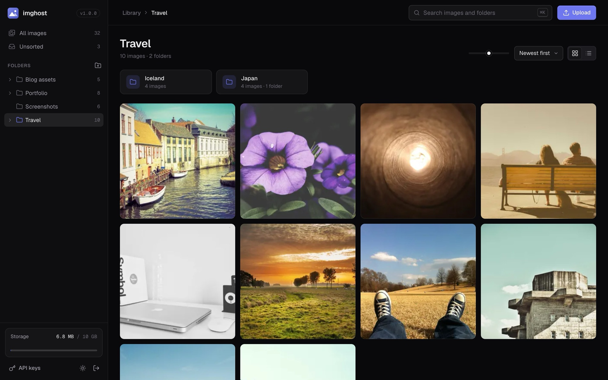
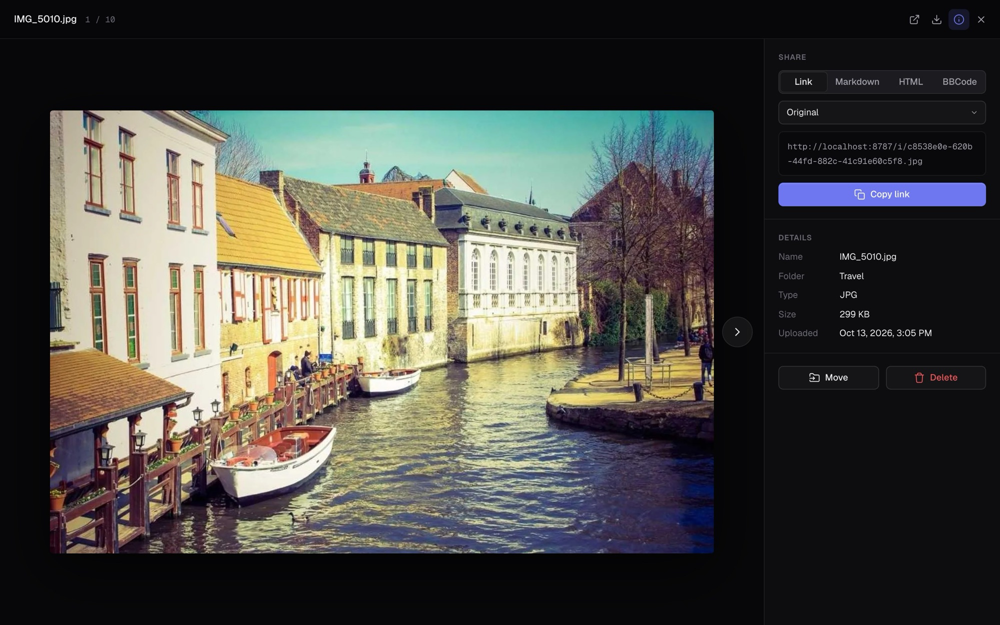
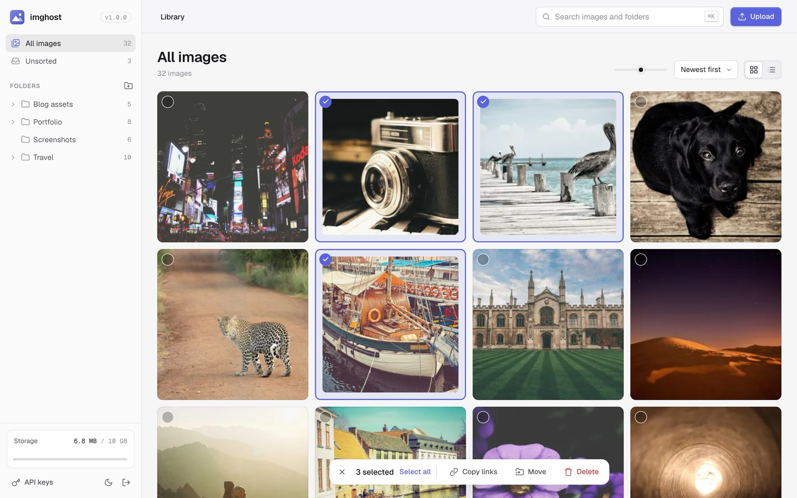
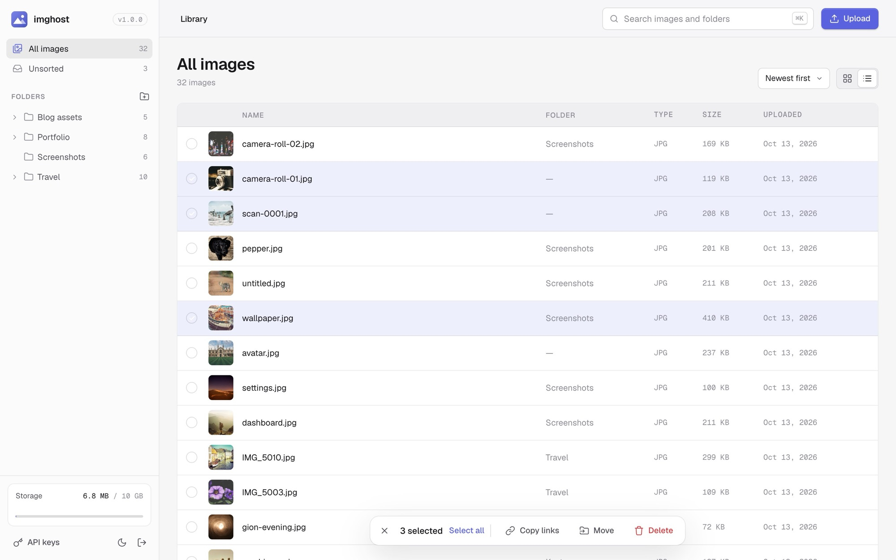
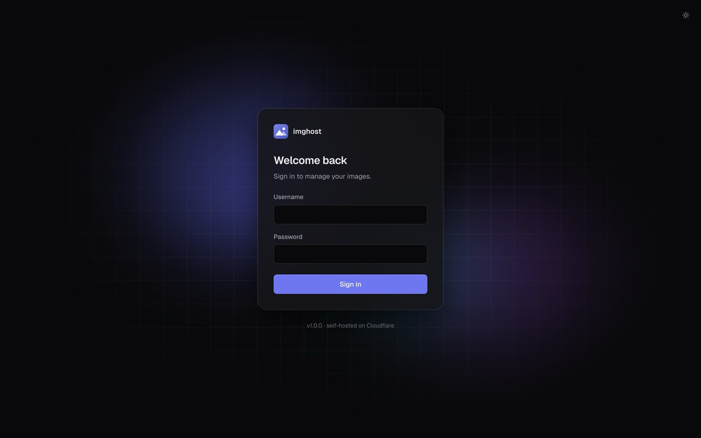

<p align="center"></p>

<h1 align="center">imghost</h1>

<p align="center">
  Self-hosted image host on Cloudflare's free tier: Workers + D1 + R2.<br>
  One admin account, nested folders, direct public links, resized variants, upload API.
</p>

<p align="center">
  
  
  <a href="https://github.com/sponsors/momardia54"></a>
  <a href="CHANGELOG.md">Changelog</a> · <a href="ROADMAP.md">Roadmap</a> · <a href="SECURITY.md">Security</a>
</p>



<details>
<summary>More screenshots</summary>

Lightbox with share panel:



Light theme, multi-select:



List view:



Login:



</details>

## Features

- **Library**: nested folders, recursive folder views, an "Unsorted" view, image and folder search
- **Upload**: drop files anywhere, paste from the clipboard, or pick files. JPG, PNG, GIF, WebP, AVIF,
  10 MB each, 3 at a time
- **Browse**: grid with adjustable thumbnail size or list view; sort by date, name or size; infinite scroll
- **Lightbox**: keyboard navigation, download, details, and copy as link / Markdown / HTML / BBCode at
  any size
- **Organize**: multi-select (click, Shift-click, Cmd/Ctrl+A), bulk move, delete and copy links, drag
  images onto folders, move dialog with folder search
- **Links**: public direct links at `/i/<key>`, resized WebP variants via `?size=`
- **API**: upload-only, revocable API keys
- Light and dark themes, responsive down to phone width, storage meter against the 10 GB R2 free tier

## Deploy

[](https://deploy.workers.cloudflare.com/?url=https://github.com/momardia54/imghost)

The button provisions the Worker, D1 database and R2 bucket, and prompts for `ADMIN_USERNAME` and
`ADMIN_PASSWORD`.

If the first build fails with `D1 binding 'DB' references database '...' which was not found`, run
once from a clone, then commit and push the updated `wrangler.jsonc`:

```bash
npm install
npx wrangler login
npm run deploy
```

### CLI

```bash
npm install
npx wrangler login
npx wrangler r2 bucket create imghost-images
npm run deploy
```

`npm run deploy` runs `scripts/ensure-d1.mjs` (finds or creates the `imghost-db` D1 database and
writes its id into `wrangler.jsonc`), builds the frontend, then runs `wrangler deploy`. With several
accounts, set `CLOUDFLARE_ACCOUNT_ID` first.

### Dashboard (Git-connected)

1. Workers & Pages → Create → import the repo.
2. Build command: `npm run build`. Deploy command: `npx wrangler deploy`.
3. After the first deploy: Worker → Settings → **Variables and Secrets** → add `ADMIN_USERNAME` and
   `ADMIN_PASSWORD` (type: Secret).

> Not under Settings → Build → Variables. Those are build-time only and the Worker cannot read them.

Until both secrets exist, the app shows a setup screen. Secrets apply without a redeploy.

If the D1 database is recreated, push-triggered deploys keep the old id. Run `npm run deploy` locally
once and push, or set the dashboard deploy command to
`node scripts/ensure-d1.mjs && npx wrangler deploy`.

## Configuration

| Name | Type | Where | Description |
| --- | --- | --- | --- |
| `ADMIN_USERNAME` | Secret | Worker runtime | Login username |
| `ADMIN_PASSWORD` | Secret | Worker runtime | Login password |

| Binding | Resource | Name |
| --- | --- | --- |
| `DB` | D1 | `imghost-db` |
| `IMAGES` | R2 | `imghost-images` |
| `TRANSFORM` | Images (transformations) | n/a |
| `ASSETS` | Static assets | `frontend-dist/` |

Set or rotate credentials (also the account recovery path):

```bash
npx wrangler secret put ADMIN_USERNAME
npx wrangler secret put ADMIN_PASSWORD
```

For a Worker that doesn't exist yet, pass them with the first deploy:

```bash
printf 'ADMIN_USERNAME=user\nADMIN_PASSWORD=pass\n' > secrets.env
npx wrangler deploy --secrets-file secrets.env && rm secrets.env
```

## Keyboard shortcuts

| Key | Action |
| --- | --- |
| `/` or `Cmd/Ctrl+K` | Search |
| `Cmd/Ctrl+A` | Select all loaded images |
| `Shift`-click | Select a range |
| `Delete` / `Backspace` | Delete selection |
| `Esc` | Clear selection, close dialog or lightbox |
| `←` `→` | Previous / next image (lightbox) |
| `i` | Toggle details panel (lightbox) |
| `c` | Copy the current snippet (lightbox) |
| `F2` / double-click | Rename folder |
| `Cmd/Ctrl+V` | Upload images from the clipboard |

## Upload API

Create a key in the UI (sidebar → **API keys**). The token is shown once.

```bash
curl -X POST https://<your-worker>.workers.dev/api/upload \
  -H "Authorization: Bearer imghost_sk_..." \
  -F "file=@photo.png" \
  -F "folder_id=<optional>"
```

Response (201): `id`, `folder_id`, `r2_key`, `original_name`, `content_type`, `size`, `created_at`,
`url`.

API keys authorize `POST /api/upload` only. Every other route requires the session cookie. No CORS
headers on the upload endpoint.

## HTTP API (session cookie)

Every installation serves an OpenAPI 3.1 description of this API at `/openapi.json`
(source: `frontend/public/openapi.json`).

| Method | Path | Description |
| --- | --- | --- |
| POST | `/api/login` | Log in (`username`, `password`) |
| POST | `/api/logout` | Log out |
| GET | `/api/me` | `{ authenticated, configured }` |
| GET | `/api/tree` | Folders with recursive image counts, `total`, `bytes` |
| POST | `/api/folders` | Create folder (`name`, `parent_id`) |
| PATCH | `/api/folders/:id` | Rename |
| DELETE | `/api/folders/:id` | Delete folder, descendants and their files |
| GET | `/api/files` | List. Query: `folder_id` (recursive), `scope=all`, `q` (name search), `sort` (`newest`, `oldest`, `name`, `size`), `limit` (max 100), `offset` or `page`. No folder or scope: unsorted images |
| POST | `/api/upload` | Upload (session or API key) |
| PATCH | `/api/files/:id` | Move (`folder_id`, `null` for unsorted) |
| DELETE | `/api/files/:id` | Delete |
| POST | `/api/files/move` | Bulk move (`ids`: up to 500, `folder_id`) |
| POST | `/api/files/delete` | Bulk delete (`ids`: up to 500) |
| GET/POST | `/api/keys` | List / create API keys |
| DELETE | `/api/keys/:id` | Revoke an API key |
| GET | `/i/:key` | Public image (no auth) |

## Image variants

`GET /i/<key>?size=<preset>` returns a WebP resized to the preset width (never upscaled).

| Preset | Width |
| --- | --- |
| `thumb` | 200 |
| `small` | 400 |
| `medium` | 800 |
| `large` | 1600 |

- No `size`, or an unknown value: the original
- Generated on first request via the Images binding, stored in R2 under `thumbs/<preset>/<key>`
- Deleted along with their image or folder
- GIFs are always served as the original
- The UI uses `small` for thumbnails and `large` in the lightbox
- Free tier: 5,000 unique transformations per month. Without the `TRANSFORM` binding, `?size=`
  serves the original

## Security

Report vulnerabilities privately, see [SECURITY.md](SECURITY.md).

- Credentials live only in Workers secrets; login compares a single SHA-256 of username and password
- Server-side sessions in D1 (`HttpOnly` cookie); per-IP login rate limit (8 failures / 15 min)
- API keys are stored as SHA-256 hashes and can only upload
- Uploads are identified by magic bytes, not the client's content type; SVG is rejected
- Strict CSP (`'self'` only for scripts, styles and fonts; no inline styles; fonts are bundled), sent
  by the Worker (`src/security.ts`) and for static assets by `frontend/public/_headers`. Keep the two
  in sync

## Local development

```bash
cp .dev.vars.example .dev.vars   # fill in ADMIN_USERNAME / ADMIN_PASSWORD
npm install
npm run dev                      # http://localhost:8787
```

If the page loads blank after rebuilding while `wrangler dev` is running: stop it,
`rm -rf .wrangler/state`, rebuild, restart.

Checks (the same ones CI runs):

```bash
npm run typecheck   # Worker, frontend and tests
npm run build       # tests need frontend-dist/ to exist
npm test            # Vitest inside the Workers runtime, local D1/R2
```

## Architecture

```
src/              Worker (fetch router, no framework)
  routes/         auth, folders, files, serve, apiKeys
  auth.ts         credential check, sessions, API keys
  db.ts           D1 schema, applied lazily on first request
  security.ts     CSP and security headers
frontend/         React + TypeScript, built with Vite into frontend-dist/
  src/components/ Sidebar, FolderTree, Toolbar, Gallery, Lightbox, Uploads, dialogs
  src/lib/        formatting, preferences, bulk actions
test/             Worker API tests (Vitest + @cloudflare/vitest-plugin)
scripts/          ensure-d1.mjs
assets/           logo and README screenshots
```

## Sponsor

imghost is free and MIT-licensed. If it saves you a hosting bill or an afternoon, you can
[sponsor its development on GitHub](https://github.com/sponsors/momardia54).

## License

[MIT](LICENSE). Demo photos in the screenshots are from [Unsplash](https://unsplash.com) via
[Lorem Picsum](https://picsum.photos).
